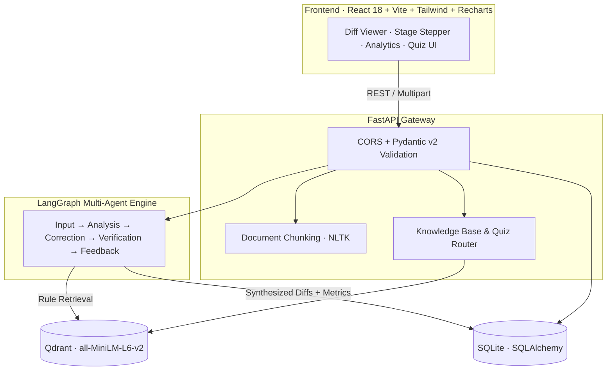
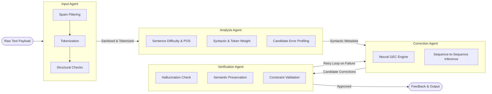

<div align="center">

# 🛡️ GrammarGuard AI

### Multi-Agent Grammatical Error Correction that *teaches*, not just rewrites

[](https://fastapi.tiangolo.com/)
[](https://reactjs.org/)
[](https://langchain-ai.github.io/langgraph/)
[](https://qdrant.tech/)
[](https://pytorch.org/)

[](https://www.python.org/)
[](https://nodejs.org/)
[](#-evaluation-benchmarks)
[](#-evaluation-benchmarks)
[](LICENSE)

**Detect · Correct · Verify · Explain · Practice**

[Overview](#-overview) •
[Features](#-core-features) •
[Use Cases](#-use-cases) •
[Architecture](#-architecture) •
[Tech Stack](#-tech-stack) •
[Quick Start](#-quick-start) •
[API Reference](#-api-reference) •
[Benchmarks](#-evaluation-benchmarks) •
[Roadmap](#-roadmap)

</div>

---

## 📖 Overview

**GrammarGuard AI** bridges the gap between raw neural grammar correction and genuine language learning. A cyclic **LangGraph** state machine orchestrates a **T5** sequence-to-sequence corrector, an autonomous **verification gate**, and a **Qdrant-powered RAG knowledge base**, ensuring every edit comes with an exact diff, error categorization, and a plain-English pedagogical explanation.

### The Problem with Typical Grammar Tools

| Problem | What Goes Wrong | GrammarGuard's Solution |
| :-- | :-- | :-- |
| **Black-box rewriting** | Text changes silently; the user learns nothing. | Surfaced as span-level diffs accompanied by categorized pedagogical rule cards. |
| **Over-correction & drift** | Generic LLMs paraphrase, strip author voice, and alter meaning. | Dedicated seq2seq model strictly constrained to grammatical repair. |
| **Single-pass blind spots** | Fixing a tense error while missing an adjacent concord error. | Verification agent audits output and routes back through iterative re-correction loops. |

---

## ✨ Core Features

- 🔍 **Interactive Diff Viewer:** Character- and token-level diffs with clear visual badges (🟩 insertions/replacements, 🟥 deletions).
- 🧠 **Multi-Agent Pipeline:** Linear decomposition through Sanitization → Profiling → Neural GEC → Verification → Feedback.
- 📚 **RAG Pedagogical Cards:** Matches detected errors against vector knowledge (`all-MiniLM-L6-v2`) to provide grammar rules, actionable tips, and contrastive examples.
- 📄 **Long-Form Document Review:** Chunked processing via NLTK for `.txt`, `.docx`, and `.pdf` files with reassembled sentence diagnostics.
- 🎯 **Dynamic Grammar Quizzes:** Auto-generates targeted multiple-choice practice directly from identified weak spots.
- 📊 **Persistent Analytics:** Tracks error frequencies (Subject-Verb Agreement, Verb Tense, Concord, Preposition Drifts, Orthography) visualized with Recharts.
- 🩺 **Environment Diagnostics:** Built-in health checks for API latency, PyTorch inference readiness, and Qdrant connectivity.

---

## 🎯 Use Cases

| Domain | Challenge | How GrammarGuard Helps |
| :-- | :-- | :-- |
| 🎓 **Education & Academia** | Passive rewriting with generic LLMs stunts student writing development. | Explains error patterns with rule cards and interactive quizzes instead of blind rewriting. |
| 💼 **Recruitment & Hiring** | Grammar slips in resumes cost candidates opportunities; LLMs risk altering technical credentials. | Corrects tense, voice, and concord while strictly preserving technical terminology and numeric data. |
| 🏢 **Enterprise & Support** | Phrasing inaccuracies in customer-facing communication impact brand credibility. | Provides low-latency pre-flight verification with clear change logs. |
| 🌍 **ESL Learners** | Language learners repeat systemic errors without structural explanations. | Surfaces recurring error distributions over time and reinforces learning with targeted exercises. |

---

## 🏗️ Architecture

GrammarGuard is structured as a decoupled, microservice-ready system separating presentation, state orchestration, vector retrieval, and neural inference.



---

### Agent Pipeline & State Machine

A shared `AgentState` flows through the directed acyclic and cyclic branches of the graph. The verification node acts as an autonomous quality gate before results are finalized.



#### Node Responsibilities

| Agent Node | Status Indicator | Core Responsibilities |
| :-- | :-- | :-- |
| **Input Agent** | `Sanitizing` | Strips malformed Unicode, validates empty payloads, filters spam, and tokenizes incoming text into structural units. |
| **Analysis Agent** | `Processing` | Profiles sentence difficulty, maps parts of speech (POS), tallies word counts, and flags preliminary anomaly candidates (Subject-Verb, Prepositions). |
| **Correction Agent** | `Generating` | Runs beam-search inference using `vennify/t5-base-grammar-correction` seq2seq model (typical latency $\approx 320\text{ ms}$). |
| **Verification Agent** | `Evaluating` | Audits against hallucinations, validates semantic preservation, checks constraints, and manages the state retry loop (`retry_count < 2`). |
| **Feedback Agent** | `Synthesizing` | Computes Myers span-level diffs, queries Qdrant for pedagogical rule cards, and produces the finalized JSON response. |

---

### Worked Example: `AgentState` Across the Pipeline

The table below illustrates the runtime transformation of `AgentState` for an input containing multiple grammatical errors:

| Step | Node | State & Payload Evolution |
| :--: | :-- | :-- |
| **1** | **Input** | `text = "She go to school every days."` · Whitespace normalized, payload bounds checked. |
| **2** | **Analysis** | `tokens = 6` · POS tagged · Flagged candidates: subject-verb anomaly (`go`), concord anomaly (`days`). |
| **3** | **Correction (Pass 1)** | `candidate = "She goes to school every days."` |
| **4** | **Verification** | Residual noun pluralization detected (`every days`) → `retry_count = 1` → State routes back to **Correction**. |
| **5** | **Correction (Pass 2)** | `candidate = "She goes to school every day."` |
| **6** | **Verification** | Semantic preservation confirmed, no hallucinations or residuals detected → **APPROVED**. |
| **7** | **Feedback** | Spans extracted: `go → goes` (*Subject-Verb Agreement*), `days → day` (*Concord*). Rule cards fetched from Qdrant and cached. |

---

## 🧰 Tech Stack

| Layer | Technologies |
| :-- | :-- |
| **Backend Framework** | Python 3.10+, FastAPI, Uvicorn, Pydantic v2 |
| **Agent Orchestration** | LangGraph (`StateGraph`, conditional edges) |
| **Neural Inference** | Hugging Face Transformers (`vennify/t5-base-grammar-correction`), PyTorch |
| **Vector Search (RAG)** | Qdrant, `sentence-transformers/all-MiniLM-L6-v2` |
| **Persistence** | SQLAlchemy, SQLite |
| **Document Parsing** | NLTK, `python-docx`, `pypdf` / `pdfplumber` |
| **Frontend UI** | React 18, TypeScript, Vite, Tailwind CSS, Lucide React, Recharts |

---

## 🚀 Quick Start

### Prerequisites

- **Python:** 3.10 or higher
- **Node.js:** 18 or higher
- Package managers: `pip` and `npm`

### 1. Clone the Repository

```bash
git clone https://github.com/your-username/GrammarGuard-AI.git
cd GrammarGuard-AI
```

### 2. Backend Setup

```bash
cd backend

# Create and activate a virtual environment
python3 -m venv venv
source venv/bin/activate        # Linux / macOS
# .\venv\Scripts\activate       # Windows

# Install backend dependencies
pip install -r requirements.txt
```

Create a `backend/.env` file:

```env
APP_NAME="GrammarGuard AI"
PORT=8000
HOST="0.0.0.0"
CORS_ORIGINS="http://localhost:5173,http://localhost:3000"
```

Start the backend service:

```bash
python main.py
```

> **Note:** The initial boot downloads the T5 model weights and sentence-transformer embeddings. Please allow a few minutes for initial model cache creation.

- **API Base:** `http://localhost:8000`
- **Swagger Documentation:** `http://localhost:8000/docs`

### 3. Frontend Setup

In a new terminal window:

```bash
cd frontend
npm install
npm run dev
```

The web client will be available at `http://localhost:5173`.

---

## 🔌 API Reference

Complete OpenAPI documentation is available interactively at `/docs`.

| Method | Endpoint | Description |
| :-- | :-- | :-- |
| `GET` | `/api/v1/health` | Backend status, hardware acceleration info, and model readiness. |
| `POST` | `/api/v1/correct` | Runs multi-agent sentence correction, diff analysis, and RAG retrieval. |
| `POST` | `/api/v1/documents/review` | Multipart upload (`.txt`, `.docx`, `.pdf`) returning chunked evaluations. |
| `GET` | `/api/v1/analytics/overview` | Aggregated metrics, error distributions, and historical trends. |
| `GET` | `/api/v1/learning/topics` | Lists indexed grammatical concepts available in the RAG store. |
| `GET` | `/api/v1/learning/quiz` | Generates diagnostic multiple-choice questions based on indexed rules. |

### Sample Request

```bash
curl -X POST http://localhost:8000/api/v1/correct \
  -H "Content-Type: application/json" \
  -d '{"text": "She go to school every days."}'
```

<details>
<summary><b>View JSON Response</b></summary>

```json
{
  "original": "She go to school every days.",
  "corrected": "She goes to school every day.",
  "edits": [
    {
      "original": "go",
      "corrected": "goes",
      "category": "Subject-Verb Agreement",
      "rule": "A third-person singular subject takes a verb ending in -s in the simple present."
    },
    {
      "original": "days",
      "corrected": "day",
      "category": "Concord",
      "rule": "After 'every', use a singular countable noun."
    }
  ],
  "retry_count": 1,
  "inference_time_ms": 320
}
```

</details>

---

## 📊 Evaluation Benchmarks

The pipeline is continuously evaluated via an automated test harness (`backend/scripts/evaluate_gec.py`) covering core syntactic and morphological error categories.

| Metric | Score | Target Threshold |
| :-- | :--: | :--: |
| **GLEU** | **94.23** | > 85.00 |
| **BLEU** | **93.24** | > 85.00 |
| **Span Precision** | **100.00%** | > 90.00% |
| **Span Recall** | **88.89%** | > 80.00% |
| **ERRANT F0.5** | **97.56** | > 75.00 |

To reproduce the benchmark figures locally:

```bash
cd backend
python scripts/evaluate_gec.py
```

> *Note: Benchmark scores reflect internal evaluation datasets covering core error distributions. Direct comparability to public shared tasks (e.g., CoNLL-2014, BEA-2019) may vary.*

---

## 🗺️ Roadmap

- [x] **Phase 1: Foundation:** React workspace, visual diff engine, and responsive layout.
- [x] **Phase 2: Neural Core:** FastAPI backend, Hugging Face seq2seq integration, structured response schemas.
- [x] **Phase 3: Agentic Flow:** LangGraph state machine with cyclic verification and conditional retry logic.
- [x] **Phase 4: Pedagogical RAG:** Qdrant integration for context-aware grammar rule lookups.
- [x] **Phase 5: Evaluation Suite:** Automated scoring against standard GEC metrics (GLEU, BLEU, ERRANT).
- [x] **Phase 6: Extended Features:** Document batching, SQLite analytics, and adaptive quiz generation.
- [ ] **Phase 7: Public Benchmarking:** Formal evaluation against CoNLL-2014 and BEA-2019 test splits.
- [ ] **Phase 8: Deployment:** Multi-container Docker Compose setup for one-command deployment.
- [ ] **Phase 9: Integrations:** Chrome extension and Google Docs workspace add-on.

---

## ⚠️ Known Limitations

- **Scope:** Tailored for English grammatical error correction.
- **Context Boundaries:** Processing is performed sentence-by-sentence; cross-sentence discourse phenomena (e.g., distant pronoun references) are not evaluated.
- **Document Scans:** Image-only (scanned) PDFs require a pre-processing OCR pipeline before ingestion.

---

## 🤝 Contributing

Contributions are welcome! Please follow these steps:

1. Fork the repository.
2. Create your feature branch: `git checkout -b feature/your-feature-name`.
3. Commit your changes: `git commit -m "feat: Add new rule matcher"`.
4. Push to the branch: `git push origin feature/your-feature-name`.
5. Open a Pull Request.

*Before submitting a PR touching inference or verification, ensure `python backend/scripts/evaluate_gec.py` passes.*

---

## 🙏 Acknowledgments

- [vennify/t5-base-grammar-correction](https://huggingface.co/vennify/t5-base-grammar-correction) for the sequence-to-sequence correction model.
- [sentence-transformers/all-MiniLM-L6-v2](https://huggingface.co/sentence-transformers/all-MiniLM-L6-v2) for compact, high-efficiency semantic embeddings.
- [LangGraph](https://langchain-ai.github.io/langgraph/), [Qdrant](https://qdrant.tech/), and [FastAPI](https://fastapi.tiangolo.com/) for agent orchestration and data infrastructure.

---

## 📄 License

Distributed under the **MIT License**. See [`LICENSE`](LICENSE) for complete terms.

<div align="center">

**If GrammarGuard AI helps your project or learning, please consider starring ⭐ the repository!**

</div>